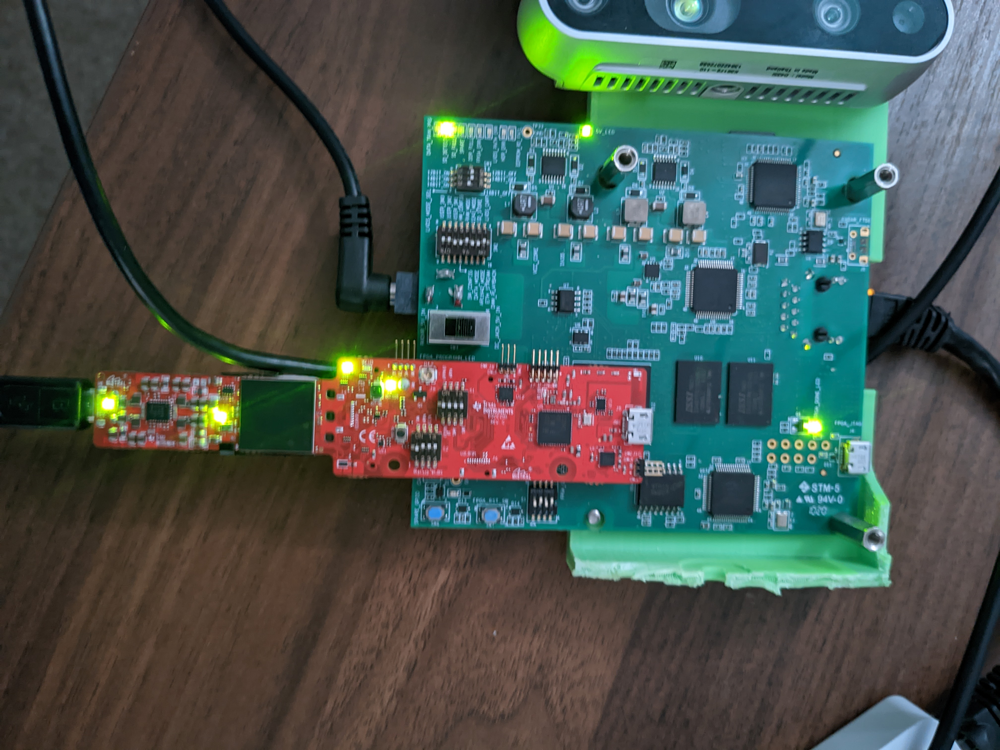
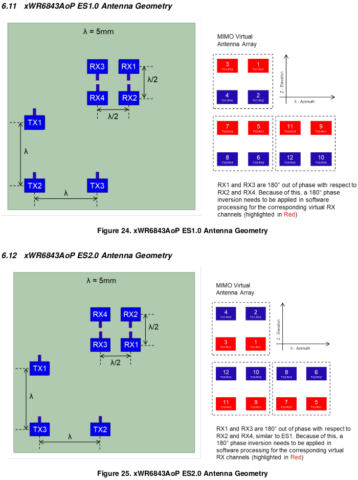

<!-- Modified by Chan Sheng Bin, 2026: rewritten for the ROS 2 port and the IWR6843AOP. See ../NOTICE. -->
# xwr_raw_ros (ROS 2)

A ROS 2 node for real-time capture of raw ADC I/Q samples from a TI mmWave radar evaluation board
through a DCA1000EVM. This is a ROS 2 port of
[ConnectedSystemsLab/xwr_raw_ros](https://github.com/ConnectedSystemsLab/xwr_raw_ros), set up and
tested for the **IWR6843AOPEVM**. The upstream driver was developed for and used in:

> **[BatMobility: Towards Flying Without Seeing for Autonomous Drones](https://dl.acm.org/doi/10.1145/3570361.3592532)**
> Emerson Sie, Zikun Liu, Deepak Vasisht
> *ACM MobiCom 2023*

> **[Radarize: Enhancing Radar SLAM with Generalizable Doppler-Based Odometry](https://arxiv.org/pdf/2311.11260)**
> Emerson Sie, Xinyu Wu, Heyu Guo, Deepak Vasisht
> *ACM MobiSys 2024*

Tested with ROS 2 Humble on Ubuntu 22.04 (NVIDIA Jetson AGX Orin) and an IWR6843AOPEVM running TI's
mmWave SDK out-of-box demo (the profiles here were made for SDK 3.6).
Upstream's other boards (xWR1843, xWR6843ISK, xWR6843ISK-ODS, xWR2944, xWR1843AOP) have not been
tested with this port, and their profiles are on upstream's branch.

## Organisation

- `nodes/radar.py`: configures the radar over its serial port, starts the DCA1000 and publishes each
  frame as `xwr_raw_ros/RadarFrameFull` on `radar_data`.
- `src/xwr_raw/`: the Python package the node and the processing use (`import xwr_raw`).
    - `radar_pub.py`, `radar_cli.py`, `dca1000.py`, `frame_buffer.py`: talking to the boards.
    - `radar_config.py`: parses a `.cfg` profile into the chirp parameters.
    - `dsp.py`: reshaping frames into radar cubes, beamforming (Capon, Bartlett), range-azimuth maps.
    - `rexo_processing.py`: range-azimuth and range-elevation heatmaps in the layout of the MMVR
      dataset (for the REXO detector).
    - `elevation.py`: elevation estimates per range bin. Exploratory: never checked against ground
      truth.
- `msg/`: `RadarFrame`, `RadarFrameStamped`, `RadarFrameFull`.
- `launch/radar.launch.py`: starts the node under the namespace `radar1`.
- `configs/6843aop/`: the chirp profiles (see the repository README).
- `udev/99-radar-isk.rules`: stable names for the EVM's serial ports (optional).
- `docs/`: upstream's copies of TI's documents.

## Getting started

See the repository README for the workspace, the build and the network setup. Then:

```bash
ros2 launch xwr_raw_ros radar.launch.py radar1_cfg:=$(ros2 pkg prefix xwr_raw_ros)/share/xwr_raw_ros/configs/6843aop/near_mimo.cfg
ros2 topic hz /radar1/radar_data
```

Launch arguments, with their defaults: `radar1` (namespace, `radar1`), `radar1_cfg` (the profile,
`configs/6843aop/near.cfg`), `radar1_cmd_tty` (`/dev/ttyUSB0`), `radar1_dca_ip` (`192.168.33.180`),
`radar1_dca_cmd_port` (`4096`), `radar1_host_ip` (`192.168.33.30`), `radar1_host_cmd_port` (`4096`),
`radar1_host_data_port` (`4098`).

## Hardware setup: IWR6843AOPEVM

Connect the wires and set the pins and switches as follows.



- Config port: `/dev/ttyISK_00` with the udev rule, otherwise usually `/dev/ttyUSB0` (pass it as
  `radar1_cmd_tty`).
- Data port: `/dev/ttyISK_01`, otherwise usually `/dev/ttyUSB1` (not used: the data comes over
  the DCA1000).
- [IWR6843AOPEVM user guide](https://www.ti.com/lit/ug/swru546e/swru546e.pdf)

The antenna image shows two hardware revisions (ES1.0 and ES2.0) with RX1 and RX2 swapped. The
elevation code assumes ES2.0 (`xwr_raw/elevation.py`, `AOP_ELEVATION_SIGN_ES2`).

Optional udev rule and serial access:

```bash
sudo cp udev/99-radar-isk.rules /etc/udev/rules.d/ && sudo udevadm control --reload-rules
sudo usermod -a -G dialout $USER    # then log out and back in
```

## DCA1000

- [Quick start guide](docs/DCA1000EVM_Quick_Start.pdf)
- [User guide](docs/DCA1000EVM_User_Guide.pdf)
- [CLI software user guide](docs/DCA1000EVM_CLI_Software_UserGuide.pdf)
- [Introduction to mmWave sensing: FMCW radars](docs/Introduction_to_mmwave_Sensing_FMCW_Radars.pdf)
- [MIMO radar](docs/MIMO_Radar.pdf)
- [Raw data capture for XWR6843 with the DCA1000](docs/mmWave_sensor_raw_data_capture_using_DCA1000_xwr6843.pdf)
- [UniFlash](https://www.ti.com/tool/UNIFLASH), to flash the mmWave SDK demo onto the radar
- [mmWave Demo Visualizer](https://dev.ti.com/gallery/view/mmwave/mmWave_Demo_Visualizer/), to make profiles

## Citation

If this driver is useful to you, please cite upstream's papers:

```bibtex
@inproceedings{sie2023batmobility,
    author = {Emerson Sie and Zikun Liu and Deepak Vasisht},
    title = {BatMobility: Towards Flying Without Seeing for Autonomous Drones},
    booktitle = {The 29th Annual International Conference on Mobile Computing and Networking (ACM MobiCom '23)},
    year = {2023},
    doi = {10.1145/3570361.3592532},
    isbn = {978-1-4503-9990-6/23/10},
}
```

```bibtex
@inproceedings{sie2024radarize,
    author = {Sie, Emerson and Wu, Xinyu and Guo, Heyu and Vasisht, Deepak},
    title = {Radarize: Enhancing Radar SLAM with Generalizable Doppler-Based Odometry},
    booktitle = {The 22nd ACM International Conference on Mobile Systems, Applications, and Services (ACM MobiSys '24)},
    year = {2024},
    doi = {10.1145/3643832.3661871},
}
```

## Acknowledgements

Upstream thanks [OpenRadar](https://github.com/PreSenseRadar/OpenRadar) and
[iwr_raw_rosnode](https://github.com/moodoki/iwr_raw_rosnode) for help and code snippets.
